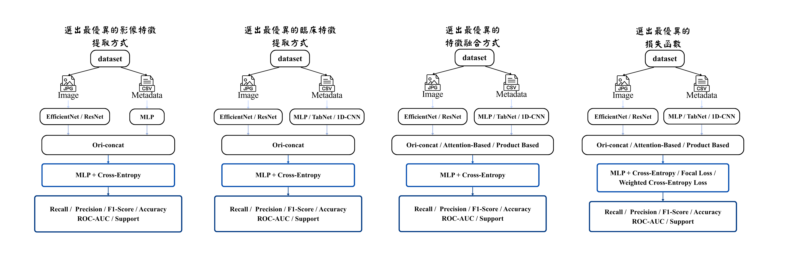

## 探討不同多模態架構於黑色素瘤預測效能之比較

以 ISIC 2020 資料集結合**皮膚影像**與**臨床資料**（年齡、性別、病灶部位），透過四階段控制實驗，比較各架構元件對黑色素瘤辨識的影響。

> 國立彰化師範大學資訊管理學系畢業專題｜獲彰師大百萬專題探索計畫支持｜TAAI 2026 投稿中
> 本 repo fork 自團隊原始專案 [thefirstwangry/multimodal-skin-lesion-classification](https://github.com/thefirstwangry/multimodal-skin-lesion-classification)，並整理檔案、補充說明文件。

### 研究架構



由於資料極度不平衡（良性與惡性約 55:1），只看 Accuracy 會掩蓋惡性病例的漏判，因此本研究以**惡性類別的 Recall 與 F1-score** 為主要評估重點。

實驗採四階段設計：每個階段固定前一階段的最佳組合，只改變一個變因，最後再以 Optuna 調整超參數。

| 階段 | 比較項目 | 候選方法 |
|---|---|---|
| 1 | 影像特徵提取 | EfficientNet、ResNet |
| 2 | 臨床資料特徵提取 | MLP、TabNet、1D-CNN |
| 3 | 特徵融合方式 | Ori-concat、Attention-based、Product-based |
| 4 | 損失函數 | Cross-Entropy、Focal Loss、Weighted Cross-Entropy |

### 實驗結果

最終架構為 **EfficientNet + MLP + Ori-concat + Focal Loss（Optuna 優化後）**。

| 實驗階段 | Accuracy | ROC-AUC | 惡性 Recall | 惡性 F1-score |
|---|---|---|---|---|
| 單一影像模型 | 0.9817 | 0.8913 | 0.0342 | 0.0620 |
| 基礎多模態 | 0.9743 | 0.8880 | 0.2137 | 0.2273 |
| Focal Loss | 0.9250 | 0.8954 | 0.5214 | 0.1971 |
| **最終架構** | **0.9470** | **0.9108** | **0.5043** | **0.2516** |

主要發現：
- 單一影像模型的 Accuracy 高達 98%，惡性 Recall 卻只有 0.03，幾乎辨識不出惡性病例。
- 加入臨床資料後，惡性 Recall 明顯提升。
- 較複雜的 Attention 與 Product 融合，在惡性 Recall 上並未優於直接串接（Ori-concat）。
- Focal Loss 能大幅提升惡性 Recall，但會犧牲部分 Accuracy 與 F1-score；經 Optuna 優化後，F1-score 回升至 0.2516。

### 程式對照

| 階段 | 實驗 | 訓練程式 | 模型定義 |
|---|---|---|---|
| 1 | 影像模型（baseline） | `train.py` | `models.py` |
| 1 | CNN | `cnn_train.py` | `cnn_models.py` |
| 2 | 1D-CNN | `efn_1dcnn_train.py` | `efn_1dcnn_models.py` |
| 2 | TabNet | `efn_tabnet_train.py` | `efn_tabnet_models.py` |
| 3 | Attention-based 融合 | `efn_mlp_atten_train.py` | `efn_mlp_atten_models.py` |
| 3 | Product-based 融合 | `efn_mlp_product_train.py` | `efn_mlp_product_models.py` |
| 4 | Focal Loss | `efn_mlp_orig_focal_train.py` | `models.py` |
| 4 | Weighted Cross-Entropy | `efn_mlp_orig_lwce_train.py` | `models.py` |
| — | Optuna 超參數優化 | `optuna_train.py` | `models.py` |

- `dataset.py`：共用的資料讀取與影像增強
- `multi_classification.py`、`efn_mlp_atten_multi_classification.py`：模型評估

### 使用技術

Python、PyTorch、EfficientNet、TabNet、Optuna、Albumentations、scikit-learn

### 執行方式

1. 依 `pytorch_conda.yml` 建立環境（Python 3.10、PyTorch 2.5.1、CUDA 12.1）。
2. 下載影像資料集 [ISIC 2020 JPG 224x224 Resized](https://www.kaggle.com/datasets/nischaydnk/isic-2020-jpg-224x224-resized)，放到 `melanoma_external_256/train/`。
3. 執行訓練，例如最終架構：

```bash
python efn_mlp_orig_focal_train.py --save-name final_focal --data-dir ./melanoma_external_256/ --image-size 256 --enet-type efficientnet-b0 --use-meta
```

### 資料來源

- 原始資料：[ISIC 2020 Challenge Dataset](https://challenge2020.isic-archive.com/)（International Skin Imaging Collaboration），請依其授權條款使用。
- `melanoma_external_256/` 中的 CSV 為資料集的臨床資料與標籤，影像檔需另外下載。

## 團隊與分工

作者：蔣典宸、王翊宇、吳芷瑩、陳映瑄、鄭秋艷、李彩儀
指導教授：翁政雄

程式由團隊成員共同開發。本人（陳映瑄）參與各階段實驗程式的共同開發與結果分析，並負責繪製研究架構圖。
